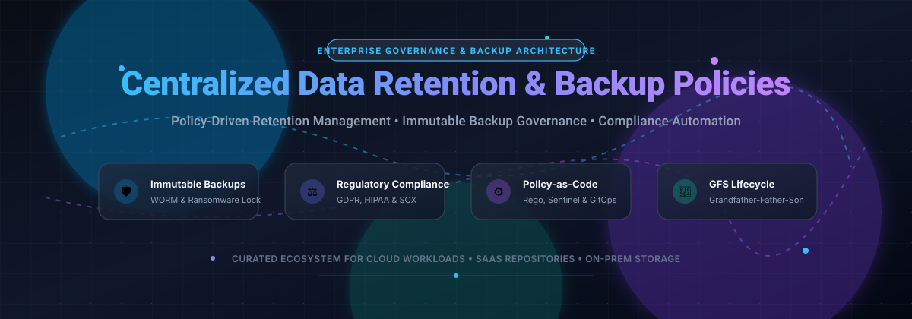

# Awesome Centralized Data Retention & Backup Policies 🛡️💾

  

  
  
  
  
  
  

---

## 🧭 Top Centralized Data Retention & Backup Policies Ecosystem

**Curated List of SaaS Products & Open-Source GitHub Projects**  
*Focused on Policy-Driven Retention Management, Immutable Backup Governance, GFS Rotation & Compliance Automation (GDPR, HIPAA, SOC 2, SOX).*  
**Last updated: March 2026**

This repository tracks notable **SaaS platforms** and **open-source tools** engineered for **Centralized Data Retention & Backup Policies**. These solutions empower DevSecOps, compliance officers, and platform engineers to define, enforce, audit, and automate lifecycle rules across enterprise endpoints, SaaS applications, Kubernetes clusters, and multi-cloud workloads. They ensure mission-critical business data is preserved for regulatory mandates, locked against tampering and ransomware threats via WORM immutability, and reliably sanitized when no longer needed.

---

## 📑 Table of Contents

- [📊 Sector Overview & Market Dynamics](#-sector-overview--market-dynamics)
- [☁️ SaaS/Hosted Platforms](#️-saashosted-platforms)
- [💻 Open-Source GitHub Projects](#-open-source-github-projects)
- [🤝 How to Contribute](#-how-to-contribute)
- [💖 Support](#-support)
- [📈 Star History](#-star-history)
- [⚖️ Disclaimer](#️-disclaimer)

---

## 📊 Sector Overview & Market Dynamics

The global enterprise data backup, retention, and recovery market is estimated at **$15.1B to $17.7B** (with the broader data protection and governance landscape exceeding **$199B**) and is projected to expand at a steady **7.2% to 10.2% CAGR** through 2035, driven by surging ransomware risks and strict regulatory mandates. The sector is **moderately to highly fragmented** rather than winner-take-all; established hyperscalers and cybersecurity conglomerates (Microsoft, Cisco, Broadcom) coexist alongside specialized enterprise data protection leaders (Druva, Cohesity, Rubrik) and a rapidly expanding cloud-native open-source policy ecosystem.

---

## ☁️ SaaS/Hosted Platforms

| SaaS Platform 🏢 | Valuation / Revenue 💰 | Primary Focus & Policy Engine 🎯 | Starting Pricing 🏷️ | Free Tier Limits 🎁 |
| :--- | :--- | :--- | :--- | :--- |
| **[Microsoft Purview Retention](https://www.microsoft.com/en-us/security/business/microsoft-purview)** | ~$3.1T Market Cap / ~$245B Annual Rev | Unified data lifecycle management, compliance records retention, and immutable M365 backup policies | **$12.00/user/mo** (Purview Compliance add-on) or **$60.00/user/mo** (M365 E5); M365 Backup is **$0.15/GB/mo** | **90-Day Free Trial** (Microsoft Purview solutions trial up to 25 licenses with full audit & retention features) |
| **[Symantec Enterprise Policy Management](https://www.broadcom.com/)** | ~$850B Market Cap (Broadcom) / ~$51B Annual Rev | Centralized policy orchestration across endpoint security, data loss prevention, web security, and audit logging | **$28.50/user/yr** (~$2.38/user/mo) for baseline Symantec Endpoint Security | **30-Day Free Trial** (available via Broadcom enterprise partner evaluation request; supports up to 100 test devices) |
| **[Cisco Secure Policy Engine](https://www.cisco.com/)** | ~$230B Market Cap / ~$54B Annual Rev | Context-aware network access & retention policy enforcement via Identity Services Engine (ISE) and SGT mappings | **~$5,000/yr** base deployment bundle for 50 endpoints (~$8.33/endpoint/mo) | **90-Day Evaluation License** (built-in full-featured evaluation mode supporting unlimited concurrent endpoints) |
| **[Palo Alto Panorama](https://www.paloaltonetworks.com/)** | ~$115B Market Cap / ~$8B Annual Rev | Centralized firewall rule management, log retention profiles, and dynamic address group policy orchestration | **$9,500 one-time base license** (PAN-PRA-25 managing up to 25 firewalls/collectors) | **30-Day Evaluation License** (virtual appliance evaluation license managing up to 25 lab firewalls) |
| **[Cloudflare Zero Trust Policies](https://www.cloudflare.com/)** | ~$38B Market Cap / ~$1.7B Annual Rev | Zero Trust access policies, egress DNS filtering, and data retention rules with geographic boundary enforcement | **$7.00/user/mo** (Standard Pay-as-you-go Plan, billed annually) | **Free Forever Plan** (up to 50 user seats, 24-hour log retention, 3 network locations, and 50 access applications) |
| **[Zscaler Cloud Policy](https://www.zscaler.com/)** | ~$30B Market Cap / ~$2.2B Annual Rev | ZIA and ZPA cloud-delivered policy engines featuring granular GenAI prompt control and data retention filters | **$72.00/user/yr** (~$6.00/user/mo for ZIA Essentials baseline package) | **14-Day Guided Proof-of-Concept** (interactive enterprise sandbox trial limited to 25 evaluation user seats) |
| **[HashiCorp Sentinel](https://www.hashicorp.com/sentinel)** | ~$35B Acquisition Valuation (IBM) / ~$600M Annual Rev | Policy-as-code framework enforcing infrastructure lifecycle guardrails, retention tagging, and compliance rules | **$0.10/managed resource/mo** (HCP Terraform Essentials Plan, hourly metered) | **Free Forever Plan** (up to 500 managed cloud resources, 1 policy set with up to 5 policies, and unlimited users) |
| **[Netskope Policy Management](https://www.netskope.com/)** | ~$7.5B Private Valuation / ~$500M ARR | DSPM and Cloud Access Security Broker (CASB) policy console tracking data retention and compliance posture | **$96.00/user/yr** (~$8.00/user/mo for entry-level CASB/SWG discovery bundle) | **14-Day Free Evaluation** (cloud sandbox environment with full CASB/DLP discovery for up to 50 test users) |
| **[Druva Policy Management](https://www.druva.com/)** | ~$2B Private Valuation / ~$250M ARR | Cloud backup policy engine covering GFS rotation intervals, immutable Data Lock, and SaaS lifecycle governance | **$4.00/user/mo** for SaaS backup or **$30.00/TB/mo** (1 credit consumption model) | **30-Day Free Trial** (unrestricted cloud backup platform access, no credit card required, up to 1TB evaluation data) |
| **[Forcepoint DLP Policy Engine](https://www.forcepoint.com/)** | ~$1.5B Private Valuation / ~$400M ARR | Predefined regulatory compliance rule sets (HIPAA, SOX, PCI-DSS) and automated document lifecycle enforcement | **$36.00/user/yr** (~$3.00/user/mo for entry-level compliance DLP tier) | **30-Day Enterprise Trial** (proof of concept evaluation including pre-configured compliance rules for up to 50 seats) |
| **[Styra OPA (DAS)](https://www.styra.com/)** | ~$250M Private Valuation / ~$25M ARR | Enterprise management plane for Open Policy Agent (OPA) authoring Rego guardrails across cloud & Kubernetes | **$70.00/node/mo** (Styra DAS Pro commercial tier) | **Free Forever Plan** (supports up to 3 individual systems/clusters and 10 OPA policy agents) |

---

## 💻 Open-Source GitHub Projects

The following open-source solutions provide policy-driven backup execution, automated Grandfather-Father-Son (GFS) prune rotation, and policy-as-code compliance orchestration:

| Project 📦 | GitHub_Stars ⭐ | Description 📝 | Key Policy Capabilities ⚙️ |
| :--- | :--- | :--- | :--- |
| **[Rclone](https://github.com/rclone/rclone)** |  | "rsync for cloud storage" CLI supporting sync, copy, crypt, and pruning across 70+ storage backends | Time-based retention policies (`--min-age`, `--max-age`), delete exclusions, and lifecycle-aware cloud sync |
| **[Restic](https://github.com/restic/restic)** |  | Fast, secure, deduplicating backup software with client-side encryption | Granular GFS pruning policy engine (`restic forget --keep-daily --keep-weekly --keep-monthly --keep-yearly`) |
| **[Duplicati](https://github.com/duplicati/duplicati)** |  | Cross-platform web UI backup client with strong encryption and cloud backend support | Built-in smart retention rules (`--retention-policy`), custom prune intervals, and volume integrity verification |
| **[Kopia](https://github.com/kopia/kopia)** |  | Fast and secure open-source backup tool with end-to-end encryption and deduplication | Native hierarchical policy engine (`kopia policy set`) defining scheduling, GFS snapshot retention, and compression rules |
| **[BorgBackup](https://github.com/borgbackup/borg)** |  | Deduplicating archiver with authenticated encryption and remote repository support | Policy-driven snapshot pruning (`borg prune`) with GFS intervals (`--keep-daily`, `--keep-weekly`, `--keep-within`) |
| **[Open Policy Agent (OPA)](https://github.com/open-policy-agent/opa)** |  | CNCF graduated general-purpose policy engine for unified policy enforcement across the cloud stack | Declarative Rego policy-as-code for verifying backup compliance, retention tags, and access boundaries |
| **[Velero](https://github.com/vmware-tanzu/velero)** |  | Kubernetes disaster recovery and workload backup utility for cluster resources and persistent volumes | Automated schedule-based TTL retention policies (`--ttl` duration flag) and target namespace lifecycle controls |
| **[Kyverno](https://github.com/kyverno/kyverno)** |  | Kubernetes-native policy management engine for validation, mutation, and generation | Enforces mandatory backup annotations, volume snapshot schedules, and data retention guardrails natively |
| **[Longhorn](https://github.com/longhorn/longhorn)** |  | Cloud-native distributed block storage system built for Kubernetes environments | Recurring backup jobs, automated snapshot retention limits, and secondary target replication policies |
| **[Microsoft 365 DSC](https://github.com/Microsoft365DSC/Microsoft365DSC)** |  | PowerShell Desired State Configuration module for orchestrating Microsoft 365 tenants | GitOps-driven policy synchronization, retention label compliance verification, and tenant configuration drift detection |
| **[Plakar](https://github.com/PlakarKorp/plakar)** |  | Modular, auditable backup and snapshot architecture with high extensibility | Dedicated retention policy manager (`plakar policy`) governing prune lifecycles via time and tag heuristics |
| **[Bareos](https://github.com/bareos/bareos)** |  | Open-source enterprise fork of Bacula for multi-host cross-platform backup and recovery | Declarative configuration files defining FileSet, Job, Pool, and Volume retention periods with automated recycling |
| **[NornicDB Retention](https://github.com/orneryd/NornicDB)** |  | High-performance Go database engine with integrated compliance and retention subsystems | Automated data sanitization rules, GDPR Article 17 "Right to Erasure" triggers, and legal hold locks |
| **[Backup Warden](https://github.com/backup-warden/backup-warden)** |  | Python-based filesystem rotation tool with pattern matching and object store integration | Filesystem GFS rotation policies (minutely, hourly, daily, weekly, monthly, yearly) and Slack notifications |

---

## 🤝 How to Contribute

We welcome community contributions! To suggest a new tool or suggest updates:

1. 🍴 **Fork the repository**.
2. 🌿 **Create a new branch** (`git checkout -b feature/add-tool`).
3. 📝 **Add/edit entries in `README.md`**:
   - For SaaS tools: include official pricing breakdown, free tier limits, and enterprise valuation/revenue.
   - For open-source tools: include GitHub repo URL, Stars_Badge, and description of retention/policy features.
4. 🚀 **Submit a Pull Request** with clear citations and documentation links.

---

## 💖 Support

Thank you for visiting and supporting this curated resource! If you find this directory valuable for your organization, infrastructure, or compliance workflows:

- ⭐ **Star this repository** to help others discover it!
- 🍴 **Fork and share** it with your engineering and compliance teams.
- ☕ **Sponsor the Maintainer:** Consider buying a coffee to support ongoing curation and maintenance via the [GitHub Sponsors Dashboard](https://github.com/sponsors/ishandutta2007).

---

## 📈 Star History

---

## ⚖️ Disclaimer

- This is a **community-curated guide** intended for informational and educational purposes; it is not an endorsement.
- Enterprise data retention policies must comply with governing legal and industry regulations (**GDPR**, **HIPAA**, **SOX**, **PCI-DSS**, and local data sovereignty laws). Always consult legal counsel before enacting automated deletion or destruction policies.
- Self-hosted open-source backup and retention engines require rigorous validation and scheduled disaster recovery drills before relying on automated prune routines for production compliance.
